# KLOR ZMK config

A [urob](https://github.com/urob/zmk-config)-style ZMK config for the
[**KLOR**](https://github.com/GEIGEIGEIST/KLOR) polydactyl: a 44-key split with
two rotary encoders, OLEDs and per-key RGB, running on nice!nano v2 controllers
(built from the [Rev 1.4 PCB](https://github.com/Lefuneste83/KLOR)). It uses a
QWERTY base layer with urob's "timeless" homerow mods, a vim-style navigation
layer and ZMK Studio, and it is covered by keymap simulation tests.



<sub>Rendered by `make draw`.</sub>

## Contents

- [Features](#features)
- [Keymap](#keymap)
- [Building and flashing](#building-and-flashing)
- [ZMK Studio](#zmk-studio)
- [Tests](#tests)
- [Customising](#customising)
- [Repository layout](#repository-layout)
- [Credits](#credits)

## Features

- **Timeless homerow mods**: Gui / Alt / Shift / Ctrl on `A S D F` and `J K L ;`.
  A mod only triggers when chorded with the *other* hand (or a thumb), so
  same-hand rolls and fast typing don't misfire.
- **Combos instead of a symbol layer**: brackets, parens and every symbol are
  two-key combos on the alpha keys (see the [cheat sheet](#combos)).
- **vim-style NAV layer**: `h j k l` arrows, page up/down, backspace/delete.
  Long-presses give line start/end, document start/end and delete-word.
- **Smart word/line selection**, modelled on
  [getreuer's select_word](https://github.com/getreuer/qmk-modules/tree/main/select_word).
  Tap once to select the word or line at the cursor, tap again to extend by one,
  hold to keep extending. Any other key stops. Lines are selected whole,
  including the line break.
- **Smart layers** that switch themselves off: num-word for typing numbers, and
  smart-mouse for mouse keys.
- **Magic shift thumb**: tap for sticky shift, double-tap for caps-word, hold
  for shift. Unlike urob's, it has no repeat key.
- **Leader key** for Portuguese accents and currency symbols (via
  `zmk-unicode`).
- **Two encoders**: volume (left) and Page Up/Down (right), one step per click.
- **Per-key RGB** (21 LEDs per half), controlled from the SYS layer.
- **ZMK Studio** on the left half, for live keymap edits without reflashing.

## Keymap

### Layers

| Layer   | How to reach it       | What's on it |
|---------|-----------------------|--------------|
| `Base`  | (default)             | QWERTY + homerow mods |
| `Nav`   | hold Space            | Left: sticky mods, Alt-Tab swapper, Shift-Tab, Alt-F4. Right: `Bspc PgDn PgUp Del` / `← ↓ ↑ →` / word & line select. `Cancel` on the shift thumb. |
| `Fn`    | hold Enter            | F1–F12 on the left (with homerow mods), media and desktop keys on the right |
| `Num`   | Num thumb (see below) | Numpad on the left hand, with homerow mods |
| `Sys`   | Fn + Num, or SYS thumb Bluetooth profiles 1–4 and clear, USB/BLE output, Studio unlock, bootloader, reset. Left hand: RGB on/off, effect, brightness −/+ (`A S D F`), hue −/+ and speed −/+ (`Z X C V`) |
| `Mouse` | `E` + `R` combo       | Cursor, scroll and clicks on the right hand. Turns off on any other key. |

NAV long-presses: `←`/`→` = line start/end, `↑`/`↓` = document start/end,
`Bspc`/`Del` = delete word. While NAV is held, mouse keys move faster; while FN
is held, they move slower.

### Thumbs and multi-purpose keys

Left thumbs, from outer to inner, then right thumbs, from inner to outer:

| Key          | Tap             | Hold    | Other |
|--------------|-----------------|---------|-------|
| `Esc`        | Esc             | –       | |
| `Gui/Tab`    | Tab             | Gui     | |
| `Space`      | Space           | NAV     | Shift + tap → `. ` and sticky shift (start a new sentence) |
| `Enter`      | Enter           | FN      | |
| `Num`        | num-word        | NUM     | Double-tap → sticky NUM |
| `Shift`      | sticky shift    | Shift   | Double-tap or Shift + tap → caps-word |
| `SYS`        | –               | SYS     | |
| `Bspc`       | Backspace       | –       | |

Shifted punctuation: `,` → `;` (Ctrl+Shift → `<`), `.` → `:` (Ctrl+Shift → `>`),
`?` → `!`.

**Num-word** stays on while you type digits and switches off at the first
non-number key (space, punctuation, …). One catch: a letter that sits under the
numpad (`W E R A S D F X C V`) typed *immediately* after a number won't switch it
off. Use `Cancel` (NAV layer, shift thumb) or end the number with a space.

### Extra KLOR keys

These are the same on every layer. Change them in `config/klor.keymap`.

| Position              | Key |
|-----------------------|-----|
| Left outer column     | `Shift` (middle row), `Ctrl` (bottom row) |
| Right outer column    | `'` (middle row), `Enter` (bottom row) |
| Encoder pushes        | `Mute` (left), `Play/Pause` (right) |
| Encoder turns         | volume (left), Page Up / Page Down (right) |

### Combos

Combos are defined by key position, so these names are the QWERTY keys. Press
both keys together.

**Horizontal, left hand**

| Keys | Output | | Keys | Output |
|------|--------|-|------|--------|
| `W E` | Esc | | `X C` | Copy (`Ctrl+Ins`) |
| `E R` | Smart-mouse | | `C V` | Paste (`Shift+Ins`) |
| `S D` | Tab (hold: Shift+Alt) | | `X V` | Cut (`Ctrl+X`) |
| `D F` | Leader (hold: Ctrl+Shift) | | `S D F` | Sticky shift + leader |

**Horizontal, right hand**

| Keys | Output | Keys on NAV |
|------|--------|-------------|
| `U I` | Backspace | Backspace |
| `I O` | Delete | Delete |
| `J K` | `(` (Shift: `<`) | `<` |
| `K L` | `)` (Shift: `>`) | `>` |
| `M ,` | `[` | `{` |
| `, .` | `]` | `}` |

**Vertical** (the top key over the key below it)

| Left | Output | | Right | Output |
|------|--------|-|-------|--------|
| `W/S` | `@` | | `Y/H` | `^` |
| `E/D` | `#` | | `U/J` | `+` |
| `R/F` | `$` | | `I/K` | `*` |
| `T/G` | `%` | | `O/L` | `&` |
| `S/X` | `` ` `` | | `H/N` | `_` |
| `D/C` | `\` | | `J/M` | `-` |
| `F/V` | `=` | | `K/,` | `/` |
| `G/B` | `~` | | `L/.` | `\|` |

### Leader key: accents and currency

Press `D`+`F` (the leader combo), then type one of these sequences:

| Sequence | Output |
|----------|--------|
| `a` `e` `i` `o` `u` | á é í ó ú |
| `n a` / `n o` | ã õ (**n**asal) |
| `h a` / `h e` / `h o` | â ê ô (**h**at) |
| `g a` | à (**g**rave) |
| `c` | ç |
| `m e` / `m l` / `m d` / `m c` / `m y` | € £ $ ¢ ¥ (**m**oney) |

Hold Shift while typing a letter sequence for the uppercase version. Output uses
Linux IBus Unicode input (`Ctrl+Shift+U`). For macOS or Windows, change
`default-mode` in `config/klor.keymap`.

## Building and flashing

The only thing you need on the host is a container engine. The `Makefile` uses
`docker`, or `podman` if docker isn't installed (override with `ENGINE=...`).
Everything else runs in the official `zmk-dev-arm` image.

```sh
make init     # once: fetch ZMK, Zephyr and modules into .zmk/
make build    # build both halves -> firmware/klor_left.uf2, firmware/klor_right.uf2
```

| Command | What it does |
|---------|--------------|
| `make build-left` / `build-right` | Build one half |
| `make build STUDIO=n` | Build without ZMK Studio |
| `make update` | Re-fetch dependencies after editing `config/west.yml` |
| `make test` | Run the [keymap tests](#tests) |
| `make draw` | Re-render `draw/klor.svg` |
| `make shell` | Open a shell in the build container |
| `make clean` | Delete build output and `firmware/*.uf2` |
| `make pristine` | Also delete the fetched workspace (`.zmk/`) |

A `docker-compose.yml` is provided if you prefer compose.

### Flashing

1. Plug in a half and **double-tap its reset button**. A `NICENANO` USB drive
   appears.
2. Copy the matching `.uf2` onto it, or run `make flash-left` /
   `make flash-right` (they copy to `/run/media/$USER/NICENANO`; override with
   `NICENANO=/path`).
3. Flash the **left** half first (it's the central), then the right.

> Never plug or unplug the TRRS cable while either half is powered. It can
> damage the controllers.

### Recovery

You can't brick the board by flashing. The nice!nano's UF2 bootloader is never
overwritten, so a double-tap on reset always brings back the `NICENANO` drive,
and you can copy any `.uf2` onto it. Any older firmware can be rebuilt from git
history. The pre-migration build (commit `fda0936`) is kept locally in
`firmware/backup/`, which is gitignored.

### Power and sleep

This build is wall-powered: the left half runs on USB, and the right half is
powered from the left over the TRRS cable. The halves still talk over
Bluetooth. Deep sleep is **off** (`config/klor.conf`), because a sleeping left
half would cut power to the right half. Re-enable it if you move to batteries.

## ZMK Studio

The left (central) half is built with
[ZMK Studio](https://zmk.dev/docs/features/studio), over USB and Bluetooth.

1. Open <https://zmk.studio> in Chrome or Edge, or use the
   [native app](https://zmk.studio/download).
2. Connect, then unlock the keyboard with the Studio-unlock key: SYS layer, top
   row, third key on the right.
3. On Linux, your user needs access to the USB serial port (e.g. the
   `uucp`/`dialout` group).

> **Pick one source of truth.** Once you *save* changes in Studio, they
> override `config/*.keymap`. Later edits to the keymap files are ignored until
> you run "Restore Stock Settings" in Studio. Studio also can't edit combos,
> macros, hold-tap timings or encoders.

## Tests

`make test` checks the keymap without hardware. It compiles the real keymap for
ZMK's `native_sim` board, replays scripted key presses and compares the keys it
sends with `tests/<case>/expected.log`.

| Case | Checks |
|------|--------|
| `base_layer` | Every base-layer key, tapped on its own |
| `homerow_mods` | Cross-hand chord = mod, same-hand roll and fast typing = letters |
| `thumb_gui` | Quick Gui+key chords on the Gui/Tab thumb |
| `nav_layer` | Arrows and backspace on NAV, space on tap |
| `selection` | Word/line select: one per tap, extend, hold, reverse, reset |
| `combos` | Esc, parens, brackets, vertical symbols |
| `num_word` | Digits until a non-number key ends num-word |
| `magic_shift` | Sticky shift and held shift |
| `leader` | Leader → `á` as an IBus Unicode sequence |

```sh
make test              # all cases
make test T=combos     # one case
make test ACCEPT=1     # after an intentional change: rewrite expected logs
```

Always review the diff of `expected.log` before committing an `ACCEPT=1` run.
Adding a case means adding `tests/<name>/native_sim.keymap`; copy an existing
one. Key positions use the KLOR labels from zmk-helpers (`LM1` = `F`, `RH0` =
Num thumb, …).

## Customising

| What | Where |
|------|-------|
| Layers, homerow mods, behaviors | `config/base.keymap` |
| Extra KLOR keys, encoders, Unicode mode | `config/klor.keymap` |
| Combos | `config/combos.dtsi` |
| Leader sequences | `config/leader.dtsi` |
| Mouse speed / acceleration | `config/mouse.dtsi` |
| Firmware options (sleep, display, BLE) | `config/klor.conf` |
| Dependency versions | `config/west.yml` (tracks [urob's pins](https://github.com/urob/zmk-config/blob/main/config/west.yml)) |
| Hardware (pins, matrix, encoders, OLED, RGB) | `boards/shields/klor/` |

Notes:

- **Homerow mod tuning**: the knobs are `tapping-term-ms` and
  `require-prior-idle-ms` in `MAKE_HRM` (`config/base.keymap`). See urob's
  [troubleshooting guide](https://github.com/urob/zmk-config#troubleshooting).
  When you fix a misfire, add a test case for it.
- **macOS**: word/line selection uses Windows/Linux cursor keys. In the
  `sw_*` macros swap `Ctrl` → `Alt`, and in the `sl_*` macros use `Gui+Left` /
  `Gui+Right` instead of `Home` / `End` (`config/base.keymap`).
- **Per-key RGB**: start colour/brightness and the brightness cap (50%) are in
  `config/klor.conf`. Toggling the LEDs off deliberately does *not* cut the
  switched VCC rail, which also powers the OLEDs and the right half. Raise the
  brightness cap with care: the left controller powers all 42 LEDs.

## Repository layout

```text
config/              user config: keymaps, combos, leader, mouse, west.yml
boards/shields/klor/ KLOR shield (kscan, matrix, encoders, OLED, RGB, physical layout)
zephyr/module.yml    makes this repo a ZMK keyboard module
tests/               keymap simulation tests (make test)
draw/                keymap-drawer config + rendered klor.svg
firmware/            build output (*.uf2, gitignored)
.zmk/                west workspace: ZMK, Zephyr, modules, builds (gitignored)
```

The repo is both a ZMK user config and a ZMK keyboard module, laid out like
ZMK's [unified config template](https://github.com/zmkfirmware/unified-zmk-config-template).
ZMK's GitHub Actions build workflow would pick up the shield automatically. The
local build passes it via `-DZMK_EXTRA_MODULES`. The west workspace lives in
`.zmk/`, so it doesn't collide with the module's `zephyr/` directory.

## Credits

- [urob/zmk-config](https://github.com/urob/zmk-config): keymap design,
  homerow mods, combos, and the ZMK modules used here (auto-layer, tri-state,
  leader-key, unicode, helpers).
- [GEIGEIGEIST/KLOR](https://github.com/GEIGEIGEIST/KLOR): the keyboard.
- [getreuer](https://github.com/getreuer/qmk-modules): the select-word idea.
- [keymap-drawer](https://github.com/caksoylar/keymap-drawer): the diagram.
